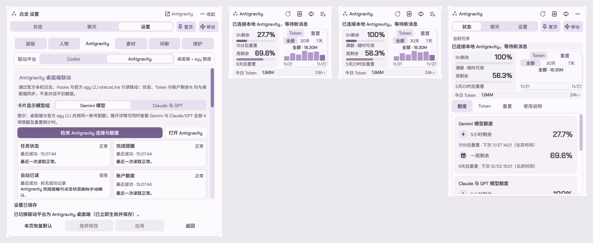
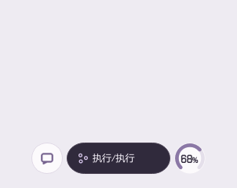
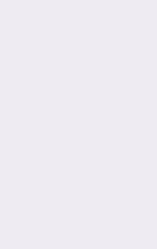
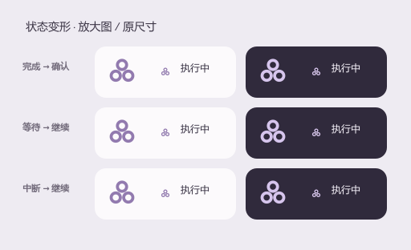

# 小白龙桌宠 · Codex & Antigravity 双源增强版（含 Live2D 打字伴侣）


一只陪你写代码的跨平台白龙桌宠：支持 **Codex / Antigravity 双 AI 助手实时联动**、**Live2D Q版机械键盘打字伴侣**、**真实账户剩余额度与 Token 统计**，完整适配 **macOS（Apple Silicon）** 与 **Windows 10/11**。

> **致谢与项目来源（Upstream Attribution）**  
> 本仓库是在原项目 **[Wunsch2048/codex-bailong-desktop-pet](https://github.com/Wunsch2048/codex-bailong-desktop-pet)**（作者：**[Wunsch2048](https://github.com/Wunsch2048)**，基于 **[jingh12312-rgb/bailong-desktop-pet](https://github.com/jingh12312-rgb/bailong-desktop-pet)** 持续演进）以及 **[Kki1ds/codex-bailong-desktop-pet](https://github.com/Kki1ds/codex-bailong-desktop-pet)** 的 macOS 社区移植版（`1.0.1-mac.1`）基础上二次开发维护的增强分支。核心桌面宠物框架、白龙角色资产、Codex 面板与统计日报体系均源自上游原作者，完整版权与授权边界见 [NOTICE.md](NOTICE.md)。

**[下载最新版本（Releases）](https://github.com/jyfjyta/codex-bailong-desktop-pet/releases)** | **[原项目（Wunsch2048）](https://github.com/Wunsch2048/codex-bailong-desktop-pet)** | [macOS 移植说明](docs/MACOS.md) | [开发与构建说明](docs/DEVELOPMENT.md) | [来源与授权](NOTICE.md)

---

## 本分支新增亮点（v1.0.1-mac.2）

在完整保留上游 v1.0.1 全部 Codex 看板、状态气泡、日报与龙娘动画能力的基础上，本分支新增了三大模块并完成了双平台适配：

### 1. Live2D Q版打字伴侣模式（macOS & Windows）

开启“打字伴侣”后，小白龙会切换到桌面 Q 版书桌视角，配备 180° 65% 白色机械键盘与鼠标垫，实时陪伴你的每一次敲击与思考：


| 特性 | 实际表现 |
| --- | --- |
| **全局键鼠实时同步** | 左/右爪随真实键盘分区按键精准敲击对应键位，右爪同步平滑追踪屏幕光标与点击动作（纯被动监听，不拦截输入、不记录任何按键文本） |
| **10 种情绪与互动反馈** | 摸头开心眨眼、单击随机切换俏皮表情（委屈泪目 / Wink / 傲娇得意 / 开心大笑 / 星星眼）、狂按退格或快速摇晃奶凶鼓嘴生气、AI 任务完成冒星星眼、长时闲置自动打瞌睡 |
| **系统级输密码防窥** | 检测到系统密码输入框（macOS Secure Input / Windows `ES_PASSWORD` & UIA `IsPassword`）时自动双手捂眼，离开密码框后立刻恢复 |
| **AI 工作自动代打** | 当 Codex 或 Antigravity 处于思考/编码/执行状态且你未亲自输入时，小白龙自动进入专注打字节奏替你“赶工” |

### 2. Codex ↔ Antigravity 双源联动与 `agy` CLI 实时额度同步

无需同时开多个桌宠，在 **设置 → 数据源** 顶部即可一键切换 **Codex** 或 **Antigravity Desktop**：



| 特性 | 实际表现 |
| --- | --- |
| **毫秒级任务状态联动** | 读取 Antigravity 桌面端会话日志并支持一键安装官方 Hooks（macOS 原生 `curl` / Windows 原生 PowerShell，零 Python 运行时依赖），实时反映思考、改文件、运行命令、等待审批与完成提醒 |
| **真实 4 项剩余额度同步** | 后台自动调用官方 `agy` CLI（通过临时 `--settings` `statusLine` 钩子静默探测，**不发起对话、不消耗任何 Token**），实时拉取与客户端/CLI 共享账户池的 4 项真实额度：`Gemini 5小时 / 一周` 与 `Claude & GPT 5小时 / 一周` 及重置倒计时 |
| **一键切换模型组与明细** | 状态卡片支持快捷切换显示 **Gemini** 或 **Claude & GPT** 额度环；展开卡片详情即可同时浏览全部 4 个额度窗口与本地累计 Token 统计 |
| **Token 柱状图与 24h 曲线** | 自动解析本机 Antigravity 对话索引与历史用量，复用柱状图与 24 小时活跃曲线展示 |

### 3. 全平台支持（macOS Apple Silicon + Windows 10/11）

| 平台 | 支持情况 | 底层实现 |
| --- | --- | --- |
| **macOS（Apple Silicon, macOS 12+）** | 提供开箱即用 `.dmg` 与源码运行 | CoreGraphics `CGEventTap` 键鼠同步、`IsSecureEventInputEnabled` 密码检测、`pty` 调用 `agy` CLI、钥匙串凭据存储 |
| **Windows 10 / 11（x64）** | 完整源码适配与打包脚本支持 | Win32 `WH_KEYBOARD_LL` / `WH_MOUSE_LL` 键鼠同步、Win32 + UIA `IsPassword` 密码防窥、PowerShell 原生 Antigravity Hooks、ConPTY 调用 `agy.exe`、高 DPI 逻辑坐标适配 |

---

## 快速安装与使用

### macOS（Apple Silicon）推荐下载 DMG

前往 [Releases](https://github.com/jyfjyta/codex-bailong-desktop-pet/releases) 下载最新安装包：

| 文件 | 用法 |
| --- | --- |
| `BailongEnhanced-1.0.1-mac.2-macos-arm64.dmg` | 双击打开，将 `小白龙.app` 拖入右侧 `Applications` 文件夹即可使用 |
| `BailongEnhanced-1.0.1-mac.2-macos-arm64.dmg.sha256` | 在下载目录运行 `shasum -a 256 -c BailongEnhanced-1.0.1-mac.2-macos-arm64.dmg.sha256` 校验完整性 |

> **首次打开提示**：macOS 社区包采用本地 ad-hoc 签名（未经过 Apple 公证）。首次打开若提示“无法验证开发者”，可在 Finder 中右键 `小白龙.app` 选择 **打开**，或在 **系统设置 → 隐私与安全性** 中点击 **仍要打开**。

- **仅卡片安装包说明**：DMG 已内置完整的 **Live2D Q版打字伴侣资源** 与状态卡片/数据面板，开箱即用；若还需要经典的 25 段全尺寸白龙动画，可在应用内 **设置 → 角色与素材** 中按需下载（轻量版或高清版，逐文件 SHA-256 校验）。
- **开启打字伴侣全局同步**：首次启用打字伴侣时，macOS 会引导授予 **输入监控（Input Monitoring）** 权限，仅用于驱动键盘/鼠标动画与密码框防窥，不记录任何按键内容。
- **启用 Antigravity 实时额度**：请确保本机已安装并登录 Antigravity 官方 CLI（`agy`，可在 Antigravity 客户端内开启或通过终端确认 `agy --version` 可用）；未安装 `agy` 时仍可正常使用会话状态联动与本地 Token 统计。

### macOS 从源码运行与打包

```bash
brew install python@3.12
/opt/homebrew/opt/python@3.12/bin/python3.12 -m venv .venv
.venv/bin/python -m pip install -r requirements-enhanced.txt
.venv/bin/python app/enhanced.py
```

构建可分发 `.app` 与 `.dmg`：

```bash
.venv/bin/python build_macos.py --cards-only --dmg
```

### Windows 10 / 11 从源码运行与打包

```powershell
py -3.12 -m venv .venv
.\.venv\Scripts\python.exe -m pip install -r requirements-enhanced.txt
.\.venv\Scripts\python.exe app\enhanced.py
```

本地打包 Windows 可执行程序或分发包：

```powershell
# 打包免安装版 / 卡片发布包
.\.venv\Scripts\python.exe build_release.py --cards-only
```

> 若希望仅使用上游原版 Windows Codex 桌宠安装包，可直接前往原作者发布页：[Wunsch2048/codex-bailong-desktop-pet Releases](https://github.com/Wunsch2048/codex-bailong-desktop-pet/releases)。

---

## 核心功能一览（含上游全部能力）

| 模块 | 功能亮点 |
| --- | --- |
| **双 AI 实时状态** | 支持 Codex 与 Antigravity 思考、编辑文件、运行命令、等待输入/审批、压缩上下文及完成提醒；最多同时显示两个会话，支持点击气泡直达原会话 |
| **不易错过的完成提醒** | 任务完成后感叹号轻晃并停留提示，点击确认或切回客户端查看后自动消除；打字伴侣同步切换为“星星眼”庆祝表情 |
| **胶囊与展开卡片** | 闲置自动收纳为小胶囊（带开口弧额度环），点击展开完整状态卡片、4 项额度详情、闲聊与设置面板 |
| **额度环与 Token 日报** | 5 小时 / 周剩余额度与倒计时；全部 / 30 天 / 7 天柱状图 + 今日 24 小时曲线；独立日报与按模型统计 |
| **经典白龙动作 & 打字伴侣** | 可在 25 段经典白龙桌面动画（需素材包）、极简卡片模式与 Live2D Q版打字伴侣模式之间自由切换 |
| **全屏让位与日常便利** | 视频全屏自动临时取消置顶（未读完成提醒优先）、登录自启、托盘找回、独立闲聊、深浅色自适应 |

| 胶囊展开正常面板 | 日报展开与收回 |
| --- | --- |
|  |  |



---

## 数据与隐私边界

- **本地数据隔离**：
  - macOS 配置、统计与已下载素材保存在 `~/Library/Application Support/BailongEnhanced`；
  - Windows 保存在 `%LOCALAPPDATA%\BailongEnhanced`；
  - 覆盖升级不会丢失你的设置、历史统计和已下载素材。
- **零侵入原则**：不修改 Codex 或 Antigravity 的登录凭据与会话内容；`agy` CLI 额度同步通过临时独立配置文件执行只读 `statusLine` 探测，不向模型发送任何提示词、不消耗额度。
- **安全与防窥**：打字伴侣的全局输入监听仅提取键位分区与光标坐标，**绝不记录、存储或上传任何击键字符**；检测到密码输入环境立即触发捂眼保护。闲聊 API Key 存放在系统安全凭据库（macOS 钥匙串 / Windows 凭据保护），不以明文随安装包分发。
- **演示截图说明**：本仓库 `docs/media/` 中的界面图表、额度百分比与 GIF 均使用隔离合成的演示数据，不含任何真实账户、聊天原文或密钥。

---

## 开发与测试

仓库内置跨平台与核心模块单元测试，可直接验证：

```bash
.venv/bin/python -m unittest test_windows_adaptation.py test_antigravity_linkage.py test_typing_companion.py test_release_version.py
```

更多文档：
- [macOS 架构与验收记录](docs/MACOS.md)
- [从源码运行与构建指南](docs/DEVELOPMENT.md)
- [上游新增功能说明](docs/新增功能说明.txt) · [完整迭代历史](docs/迭代历史.txt)
- 本分支问题反馈：[jyfjyta/codex-bailong-desktop-pet Issues](https://github.com/jyfjyta/codex-bailong-desktop-pet/issues)

---

## 来源与许可

本项目遵循清晰的上游演进脉络，在此向所有原作者致谢：

1. **原版白龙桌宠基础与角色形象**：[jingh12312-rgb/bailong-desktop-pet](https://github.com/jingh12312-rgb/bailong-desktop-pet)
2. **上游 Codex 增强版桌宠原作者**：**[Wunsch2048/codex-bailong-desktop-pet](https://github.com/Wunsch2048/codex-bailong-desktop-pet)**（v1.0.1，完成界面重构、Codex 联动、额度与日报体系、工作动作与部署架构）
3. **macOS 社区移植基线**：[Kki1ds/codex-bailong-desktop-pet](https://github.com/Kki1ds/codex-bailong-desktop-pet)（`1.0.1-mac.1`）
4. **本仓库扩展（[jyfjyta/codex-bailong-desktop-pet](https://github.com/jyfjyta/codex-bailong-desktop-pet)）**：新增 Live2D Q版打字伴侣（10 表情与密码防窥）、Antigravity 双源联动与 `agy` CLI 真实四项额度实时同步、以及跨平台（macOS + Windows 10/11）统一适配。

原项目未随基线提供统一的开源代码 LICENSE；本仓库严格沿用上游授权边界，**不擅自将整体项目标注为 MIT 或授予商业再分发许可**。详细说明见 [来源与授权说明（NOTICE.md）](NOTICE.md)、保留的 [原素材说明](docs/upstream/ASSETS.md) 与 [v0.4.1 素材说明](docs/upstream/ASSETS-v0.4.1.md)。

本项目为独立第三方桌面工具，与 OpenAI、Codex、Google、Antigravity 官方均无隶属关系。
